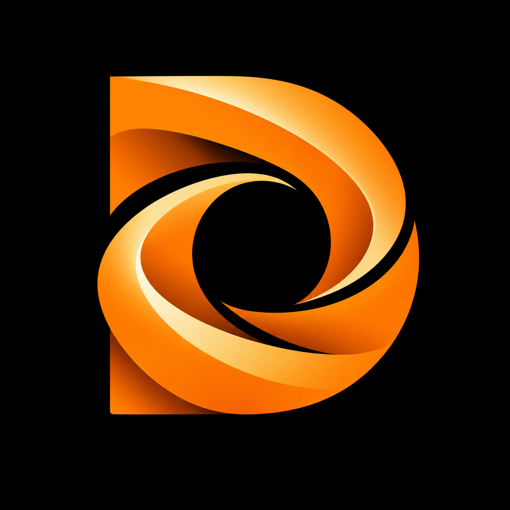
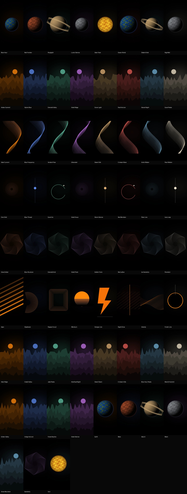

<p align="center"></p>
<h1 align="center">DepthWall</h1>
<p align="center">A little space. A lot of depth.</p>

A personal, no-root Android wallpaper app with AMOLED blacks and papaya-orange accents. Designed for the OnePlus 7T Pro McLaren 4G (`hotdog`) and crDroid on Android 17. **Physical-phone validation is pending; emulator results are recorded separately.**

## Inside

- **Explore:** 64 original static illustrations, including sixteen 4K portrait car, theme and space designs, search, category/colour filters, favourites, crop positioning, home/lock application and image export.
- **Best for your phone:** a curated Explore row for the OnePlus 7T Pro's 1440 × 3120 AMOLED panel. It mixes eleven new papaya, carbon and space originals (true black above the clock, clean of the curved edges) with the best existing stills and the live Sun scene.
- **Super:** seven native OpenGL worlds — Earth, Mars, Saturn, Moon, Snow Mountain, Geometry and Sun — with adjustable performance.
- **Depth Studio:** 12 prepared layered scenes, transparent foreground import, a manual erase/restore mask editor, parallax and optional digital, minimal or analogue clocks.
- **Library:** offline downloads, local imports, saved favourites, settings and optional hourly, six-hourly or daily static rotation.
- **Online collections:** paginated NASA originals, SFW Wallhaven, Wikimedia, and ESA / ISRO / JAXA / CSA collections via Commons. Filter by verified 4K source dimensions and keep creator credits and source links.
- **Website import:** paste an accessible HTTPS wallpaper page or direct image link, including official space galleries and wallpaper sites. Choose an original image from the detected candidates; sites requiring browser access can still be downloaded there and imported locally.
- **Phone and depth settings:** Papaya, Space blue and AMOLED monochrome palettes; OnePlus 7T Pro 1440 × 3120 export profile; optional 2160 × 4680 portrait export; persistent depth/clock defaults and explicit updates to an active depth wallpaper. Android’s live wallpaper settings button opens these controls directly.
- **crDroid AOD setup:** a direct system AOD settings shortcut and read-only compatibility report for the OnePlus 7T Pro McLaren 4G (`hotdog`). Wallpaper rendering/sensors pause on ambient displays; displaying DepthWall imagery during AOD still requires a supported privileged ROM integration.
- No app download-count quota, ads, accounts, subscriptions, analytics or hosted backend. Provider rate limits, source rights and device storage still apply. Downloads retain originals; smaller images are never upscaled into claimed 4K detail.

See [sources, downloads and phone settings](docs/ONLINE_WALLPAPERS.md) for supported integrations and limitations.

### Original Super Wallpaper ports

The six Xiaomi/HyperOS families are **separate third-party applications**. DepthWall links their sources, inspects locally selected APKs, detects installed wallpaper services, and opens public configuration activities and Android's wallpaper picker. The exact linuxct Earth and Mars releases are linked as legacy options.

Original pack APKs are not bundled. All eight referenced binaries were inspected; the six modern packages install on the Android 17 emulator and expose 18 scenes. During the v1.0.1 cold-process retest, all 18 showed actual home-screen imagery at 5 and 15 seconds with the exact service bound; 17 showed imagery in preview by 40 seconds, while Bahram Vallis remained black in both preview samples. **This is not a stable 18/18 pass:** full logs contained four native crashes across Croatia, Pahrump Hills and Bahram Vallis, with home imagery visible after recovery. Empty crash-buffer captures missed those events.

The retest used a neutral wallpaper and stopped port processes before each scene, plus host-backed guest ANGLE with a nonconformant GLES testing override. A five-scene warm-switch follow-up also showed imagery, but Longji and Bahram each produced two native failures during switching and recovery. Neither run establishes stable switching across all scenes or phone support. The v1.0.1 build passes 13 unit and 14 device tests (one destructive fixture skipped), and the signed APK installs as an update. Native idle rendering and lifecycle measurements are in the [performance report](docs/PERFORMANCE.md). See the [per-scene report](docs/COMPATIBILITY.md), [crash analysis](docs/port-errors.json), and [graphics reproduction notes](docs/AOD_AND_EMULATOR.md).

The two ARMv7-only legacy releases cannot install on the ARM64-only emulator. The seven **DepthWall original** scenes are independently implemented, stylised alternatives. Use **Use DepthWall original** on a pack card if its original port is slow, black or unreliable; quality and battery controls apply to these native scenes. Sun has no verified original port in the linked collection.

## Install and build

Download the signed APK from [Releases](https://github.com/Srimi1/depthwall/releases). See [installation and first use](docs/INSTALL.md), [compatibility and remaining checks](docs/COMPATIBILITY.md), [architecture](docs/ARCHITECTURE.md), and [privacy](docs/PRIVACY.md).

Build with JDK 17 and Android SDK platform **37.0**:

```sh
./gradlew assembleDebug testDebugUnitTest lintDebug
./gradlew connectedDebugAndroidTest
```

For a personally signed release, run `python3 tools/create_personal_key.py`, then `./gradlew assembleRelease`. The key and credentials stay outside Git. Preserve them to sign future updates. Dependency versions, Gradle wrapper, source assets and artwork-generation code are checked in. Use the [signed release workflow](docs/RELEASING.md) to verify the existing signing identity, publish to this repository, and check the uploaded APK against its checksum.

## Artwork and identity



The [logo master](branding/depthwall-logo.png), Android adaptive/monochrome launcher icons, and artwork generators ([catalogue](tools/generate_art.py), [car and theme extras](tools/generate_extra_art.py), [phone collection](tools/generate_device_art.py)) are included. Wallpaper artwork is original generative illustration. The logo's generation brief is recorded in [branding/PROMPT.md](branding/PROMPT.md). No Xiaomi, OnePlus or McLaren branding is used in the app identity.

DepthWall's optional clock is drawn inside its own wallpaper. The native crDroid clock remains controlled by the ROM. Wallpaper AOD requires a restricted Android permission that current crDroid retains; this normally installed no-root APK cannot enable it. See [AOD support](docs/AOD_AND_EMULATOR.md).
